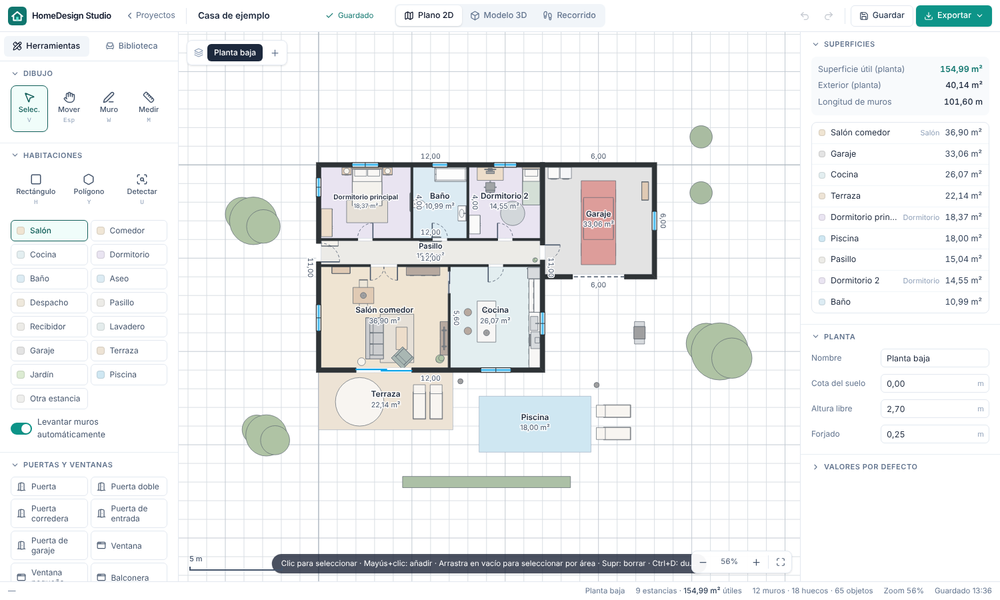
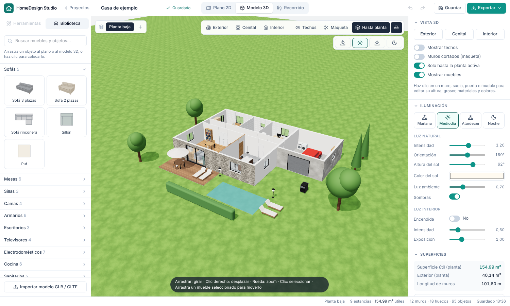
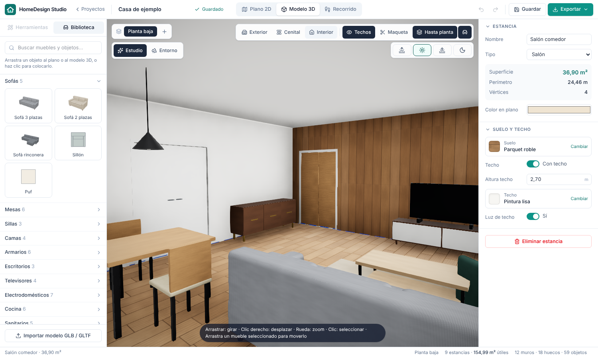
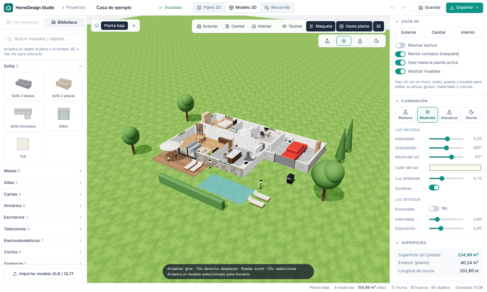
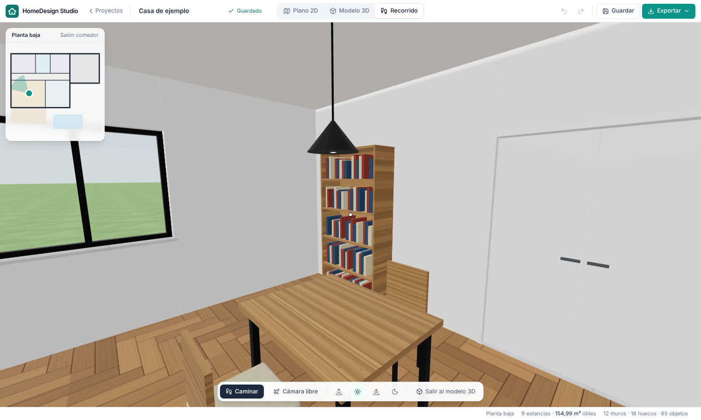
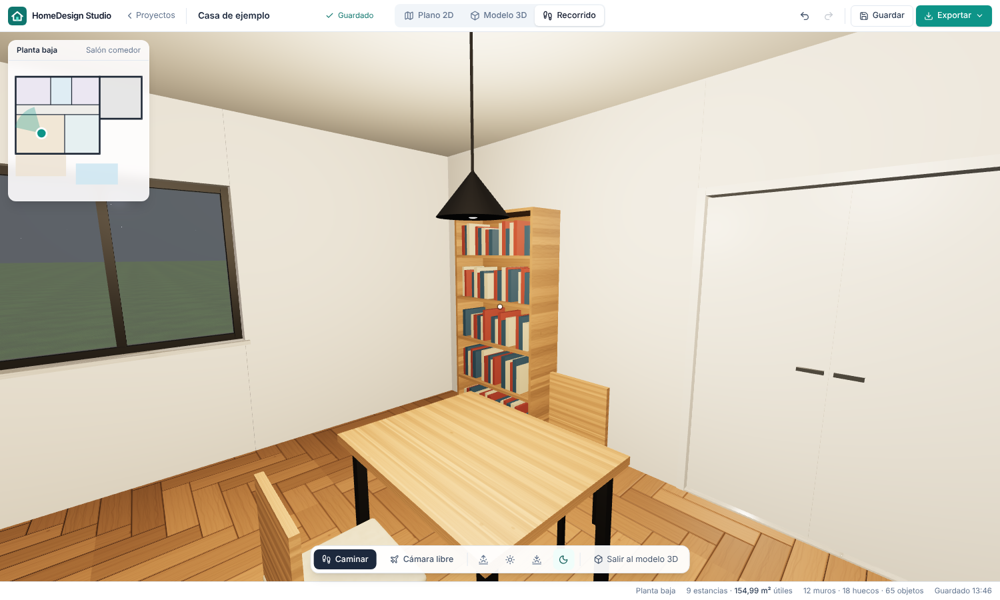
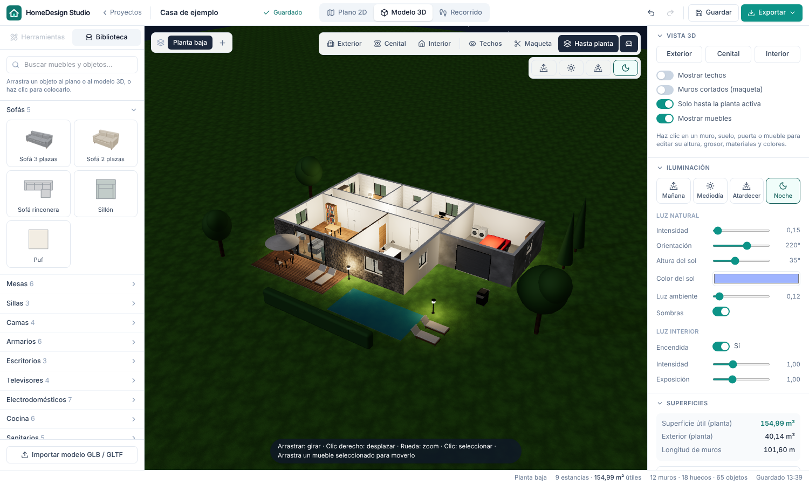
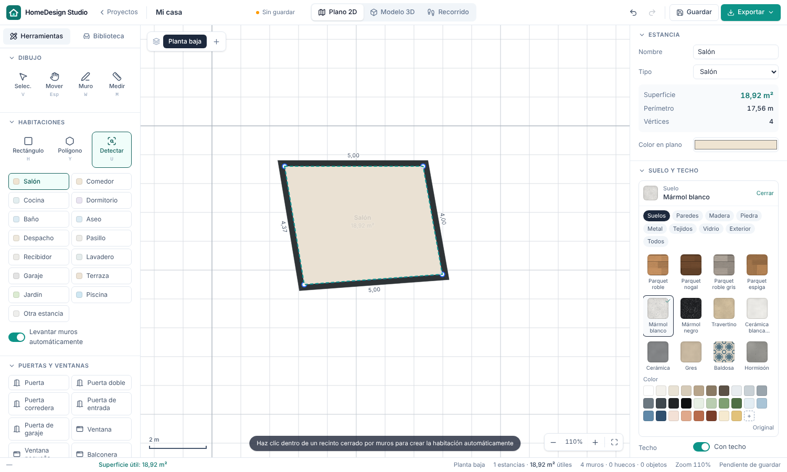
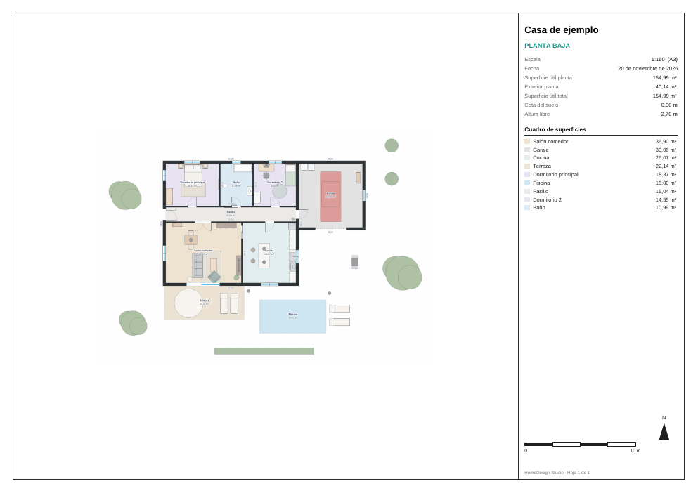

# HomeDesign Studio — Diseño de casas

Aplicación de escritorio para **diseñar tu vivienda desde cero en un plano 2D**,
verla convertida automáticamente en un **modelo 3D** y **recorrerla por dentro en
primera persona**, como en un videojuego. Funciona sin conexión, sin cuentas y
guarda los proyectos en tu propio equipo.





| Vista interior | Vista maqueta (muros cortados) |
|---|---|
|  |  |
| **Recorrido interior (día)** | **Recorrido interior (noche)** |
|  |  |
| **Ambiente de noche** | **Material del suelo** |
|  |  |

## Funcionalidades

### Plano 2D
- Lienzo con cuadrícula (5 cm – 1 m), zoom con la rueda y desplazamiento (botón central, derecho o Espacio).
- **Muros** por clic o arrastre, encadenados. Escribe la longitud (`3,5` o `350cm`) y pulsa **Enter** para una medida exacta. Grosor, altura, longitud y ángulo editables.
- Ajuste (*snap*) a cuadrícula, extremos y puntos medios de muros, ángulos (0/45/90°, 15° con Mayús) y alineaciones. **Alt** desactiva el ajuste.
- **Habitaciones** rectangulares (también tecleando `4x3`), poligonales o **detectadas automáticamente** al hacer clic dentro de un recinto cerrado por muros. Superficie útil calculada en m².
- Tipos de estancia: salón, comedor, cocina, dormitorio, baño, aseo, despacho, pasillo, recibidor, lavadero, garaje, terraza, jardín, piscina…
- **Puertas y ventanas** sobre los muros: puerta, doble, corredera, de entrada, de garaje, ventana, ventana pequeña, balconera, ventanal corredero y fija.
- Selección simple, múltiple (Mayús) y por área; mover, duplicar, copiar/pegar, eliminar; tiradores para extremos de muros, vértices, giro y tamaño de muebles.
- **Cotas** persistentes con la herramienta Medir, longitudes de muros y superficies en el plano.
- Varias **plantas**, con la planta inferior como referencia.

### Modelo 3D
- Conversión automática y en tiempo real del plano: muros con uniones a inglete y huecos reales, suelos, techos, puertas y ventanas integradas, muebles.
- Dos estilos: **Estudio** (presentación de arquitectura sobre fondo gris, como una maqueta) y **Entorno** (cielo, terreno y jardín).
- Acabado de calidad: oclusión ambiental (N8AO), sombras suaves, antialiasing SMAA y tone mapping ACES.
- Cámara orbital con vistas **exterior, cenital e interior** (gran angular); techos ocultables, vista de **maqueta** y visualización planta a planta.
- Selección de muros, suelos, huecos y muebles para editar alturas, grosores, materiales y colores; los muebles se pueden arrastrar sobre el suelo.

### Recorrido virtual
- Primera persona a 1,65 m: **WASD** para moverse, **ratón** para mirar (arriba y abajo), **Mayús** para correr.
- **Colisiones** con muros, antepechos, ventanas y muebles; las **puertas se abren solas** al acercarte.
- **Cámara libre** (`F`) para volar sin restricciones (`E`/`Q` subir y bajar).
- Minimapa con la posición, la estancia actual y teletransporte con un clic.

### Biblioteca
95 objetos paramétricos en 16 categorías (sofás, mesas, sillas, camas, armarios,
escritorios, televisores, electrodomésticos, cocina, sanitarios, duchas y bañeras,
lámparas, decoración, climatización, exterior y estructura —escaleras, pilares y
barandillas—) con miniaturas 3D. Se arrastran al plano o al 3D,
se apoyan solos contra las paredes y se pueden mover, girar, redimensionar con
medidas exactas y cambiar de material y color pieza a pieza. También se pueden
**importar modelos GLB/GLTF** propios, que se guardan dentro del proyecto.

**Amueblar estancia.** Selecciona una estancia con tipo (dormitorio, salón,
cocina, baño, despacho, garaje, pasillo, lavadero, terraza o jardín) y pulsa
*Amueblar estancia*: la app coloca los muebles típicos contra las paredes, sin
tapar puertas ni ventanas y dejando paso. Se deshace con un clic.

**Televisores y estanterías configurables.** El televisor se elige por **pulgadas**
(16:9) y la app calcula la pantalla, la **distancia de visión ideal** (que dibuja
en el plano como una zona verde delante de la TV), la distancia real al sofá, si
el tamaño es adecuado (o qué pulgadas recomendaría), la altura del centro de la
pantalla y si cabe en el mueble de TV. Para **subir o bajar la tele** usa
*Desde el suelo* en Posición o *Centro a* en Configuración (la altura del centro
de la pantalla; lo cómodo es ~1,0–1,1 m sentado), con los botones − / + en el móvil. Las estanterías se configuran por medidas,
**baldas y módulos** (también estantería de cubos y baldas de pared) y se calcula
el hueco libre, los metros de balda, la capacidad aproximada de libros y si las
baldas son demasiado largas. Para cualquier mueble avisa si **sobrepasa el techo,
tapa una puerta o ventana, sobresale de la pared o choca con otro mueble**.

### Materiales e iluminación
- Suelos de parquet (lamas y espiga), mármol, cerámica, baldosa hidráulica, hormigón, moqueta, tarima, césped, grava…
- Paredes con pintura de cualquier color, estuco, ladrillo, piedra, hormigón visto, paneles de madera y azulejo.
- Texturas generadas por la propia aplicación (sin descargas) a escala real y teñibles; la madera tiene veta real (fibras, anillos y poros) a 1024 px.
- Ambientes **mañana, mediodía, atardecer y noche**; sol con sombras configurable (intensidad, orientación y altura), luz ambiente, exposición, luces de techo automáticas y lámparas con intensidad y color.

### Proyectos y exportación
- Lista de proyectos con miniaturas: crear, abrir, **duplicar**, **renombrar**, eliminar, importar y exportar (`.hdsp`).
- **Guardado en la nube con Supabase** (opcional): tus proyectos en tu cuenta, en el móvil, el ordenador y la web.
- **Autoguardado** a los 1,5 s de cada cambio, guardado manual (`Ctrl+S`) y guardado al cerrar.
- Escritura atómica en disco con copia de seguridad `.bak` (la versión de escritorio recupera la copia si un fichero se daña).
- Exportación de **planos PNG**, **planos PDF** (A3 a escala 1:50/1:100… con cajetín y cuadro de superficies), **modelo 3D GLB/GLTF** y **capturas 3D**.



## Instalación y uso

Requisitos: [Node.js](https://nodejs.org) 20 o superior.

```bash
npm install            # instala las dependencias
npm run electron:dev   # abre la aplicación de escritorio en modo desarrollo
```

Otras órdenes:

| Orden | Para qué sirve |
|---|---|
| `npm run dev` | Ejecuta la interfaz en el navegador (http://localhost:5173) |
| `npm run electron:start` | Compila y abre la versión de escritorio de producción |
| `npm run dist:win` | Instalador de Windows (`release/*.exe`) |
| `npm run dist:mac` | Imagen de macOS (`release/*.dmg`, hay que generarla en un Mac) |
| `npm run dist:linux` | AppImage de Linux |
| `npm test` | Tests de geometría, colisiones, validación, historial, muebles y nube |
| `npm run typecheck` | Comprobación de tipos de TypeScript |

Al empezar, pulsa **Abrir casa de ejemplo** para explorar una vivienda completa
(dormitorios, baño, salón comedor, cocina, garaje, terraza y piscina) o
**Nuevo proyecto** para empezar desde cero.

**¿Dónde se guardan los proyectos?** En la versión de escritorio, en la carpeta de
datos de la aplicación (`Archivo → Abrir carpeta de proyectos`). En el navegador,
en IndexedDB. Con sesión iniciada en Supabase, en tu cuenta en la nube. Los
ficheros `.hdsp` exportados se pueden abrir con doble clic.

### Guardar en la nube (Supabase)

1. Crea un proyecto gratuito en [supabase.com](https://supabase.com).
2. En **SQL Editor** ejecuta [`supabase/schema.sql`](supabase/schema.sql): crea la
   tabla `projects` con seguridad por filas (cada usuario solo ve los suyos).
3. En **Project Settings → API** copia la **URL del proyecto** y la clave
   **pública** (`anon` o `sb_publishable_…`). Nunca uses la `service_role` ni la
   secreta: la app las rechaza.
4. Dale la URL y la clave a la app de una de estas formas:
   - En la app: **Guardar en la nube** (pantalla de proyectos) → pega la URL y la
     clave → *Conectar*. Se recuerda en ese dispositivo.
   - Para todos los dispositivos a la vez: en Cloudflare (Workers → *paginamiquel*
     → Settings → Build → Variables) añade `VITE_SUPABASE_URL` y
     `VITE_SUPABASE_ANON_KEY` y vuelve a desplegar. En local, en un fichero `.env.local`.
5. Entra o crea tu cuenta con email y contraseña. Con sesión iniciada los
   proyectos se guardan automáticamente en la nube; *Subir a la nube* copia los que
   tenías en el dispositivo. Al cerrar sesión se vuelve al guardado local.

Si Supabase tiene activada la confirmación de email, abre el enlace que llega
antes de entrar (o desactívala en *Authentication → Sign In / Providers → Email*).
Dentro de Claude la página no puede conectarse a servicios externos: usa la web
publicada en Cloudflare o la app de escritorio.

### Web (Cloudflare) y móvil

`wrangler.jsonc` despliega la carpeta `dist` como sitio estático en Cloudflare
Workers: cada push compila con `npm run build`. La interfaz se adapta al móvil
(barra inferior, paneles deslizantes, pellizcar para hacer zoom, joystick en el
recorrido).

## Atajos de teclado

| Atajo | Acción |
|---|---|
| `1` / `2` / `3` | Plano 2D / Modelo 3D / Recorrido |
| `V` `W` `H` `Y` `U` `M` | Seleccionar, Muro, Habitación rectangular, poligonal, Detectar, Medir |
| `D` / `N` | Colocar puerta / ventana |
| `Ctrl+Z` / `Ctrl+Y` | Deshacer / rehacer |
| `Ctrl+S` | Guardar |
| `Ctrl+C` / `Ctrl+V` / `Ctrl+D` | Copiar / pegar / duplicar |
| `Supr` | Eliminar selección |
| Flechas (Mayús ×10) | Desplazar la selección |
| `R` (Mayús: 15°) | Girar muebles 90° |
| `F` | Encuadrar el plano (2D) · Cámara libre (recorrido) |
| `Esc` | Cancelar / terminar / soltar el ratón |

## Arquitectura

React 19 + TypeScript, Vite, Three.js con React Three Fiber y Drei, Zustand + Immer,
Tailwind CSS y Electron. Un **único modelo de datos** (`ProjectDoc`) alimenta el
plano, el 3D y el recorrido, de modo que todo está siempre sincronizado.

```
electron/        proceso principal y preload (guardado atómico, diálogos, cierre seguro)
src/core/        geometría y utilidades puras
src/modules/     FloorPlan · Walls · Rooms · DoorsAndWindows · Furniture · Materials ·
                 Lighting · Editor2D · Editor3D · FirstPersonController · ProjectManager · UI
src/store/       projectStore (documento + historial) y editorStore (interfaz)
supabase/        esquema SQL para el guardado en la nube
```

El diseño completo (modelo de datos, sistema de coordenadas, sincronización 2D/3D,
historial, persistencia y decisiones técnicas) está en
[`docs/ARQUITECTURA.md`](docs/ARQUITECTURA.md).

## Limitaciones conocidas y próximos pasos
- Las plantas se apilan, pero en el recorrido se cambia de planta con el selector (no hay subida física por escaleras).
- No hay generador de tejados inclinados; la última planta se cierra con un techo plano.
- Las texturas son procedurales; se pueden añadir texturas fotográficas en el módulo `Materials`.
